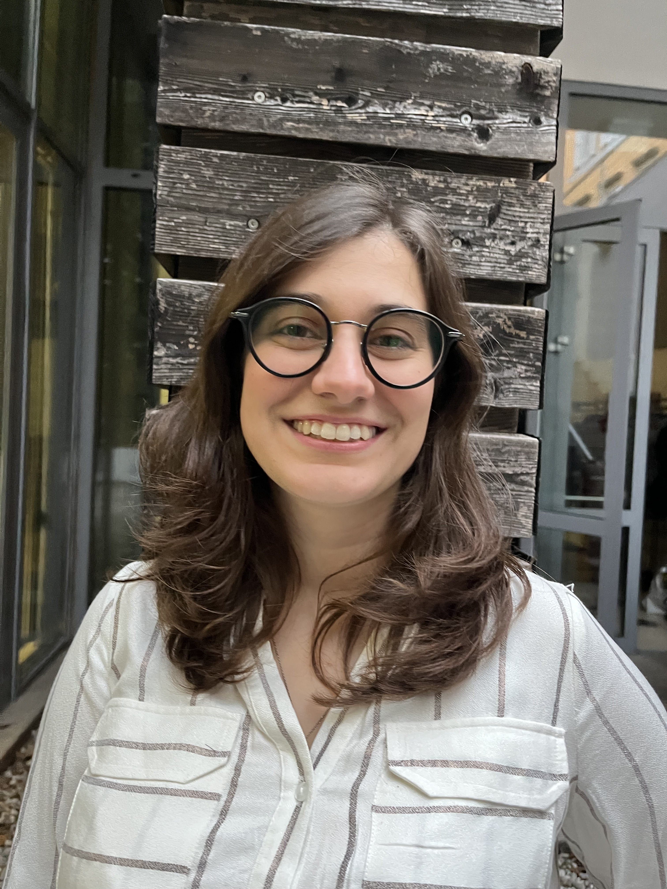

::: {.hero}
::: {.hero-photo}
{fig-alt="Elisa Baldazzi"}
:::

::: {.hero-text}
# Elisa Baldazzi {.hero-name}

[Ph.D. Candidate in Economics, University of Bologna]{.hero-role}

**I am on the 2026/27 Economics job market.**

I am a Ph.D. candidate in Economics at the [University of Bologna](https://www.unibo.it/en/homepage), supervised by [Pietro Biroli](https://sites.google.com/site/pietrobiroli/) and [Marina Della Giusta](https://mardelgiu.com/), and a Research Assistant at the University of Trento. In 2025–26 I was a visiting Ph.D. student at the [London School of Economics](https://www.lse.ac.uk/), hosted by [Almudena Sevilla](https://www.lse.ac.uk/people/almudena-sevilla).

My research is in the **economics of education**, **gender economics** and **applied microeconomics**. My job market paper, [*"Be Prepared" for School: Scouting and School Outcomes in England*](research.qmd#job-market-paper), studies how access to a local Scout or Girlguiding group affects school absence, behaviour and attainment.

[[elisa.baldazzi3@unibo.it](mailto:elisa.baldazzi3@unibo.it)]{.hero-email}

::: {.hero-links}
[ Scholar](https://scholar.google.com/citations?hl=en&user=skYW2pgAAAAJ)
[<i class="bi bi-linkedin"></i> LinkedIn](https://www.linkedin.com/in/elisa-baldazzi-351a18158/)
[<i class="bi bi-twitter-x"></i> X](https://x.com/elibaldazzi)
[<i class="bi bi-github"></i> GitHub](https://github.com/elisabaldazzi)
:::
:::
:::

## News

::: {.news}
- [Jan 2027]{.news-date} I will present at the [CSWEP session of the AEA/ASSA Annual Meeting](https://www.aeaweb.org/about-aea/committees/cswep/news-and-events/annual-meeting) in Washington, DC.
- [Dec 2026]{.news-date} I will present at the [19th UniTO-CCA Ph.D. Workshop in Economics](https://www.workshopecon.carloalberto.org/) in Turin (December 14–15).
:::
